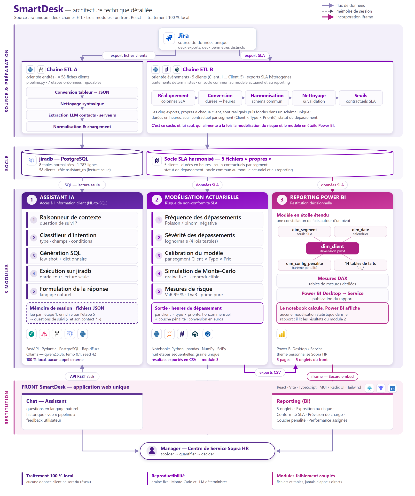
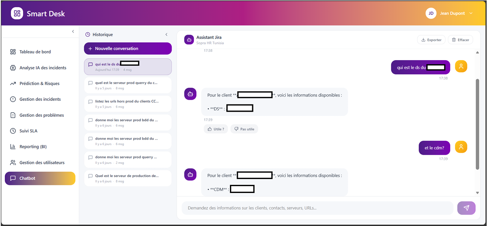
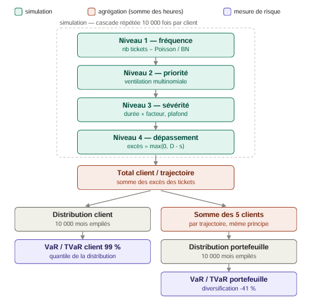
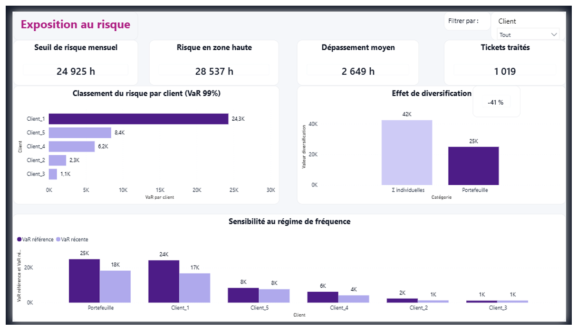
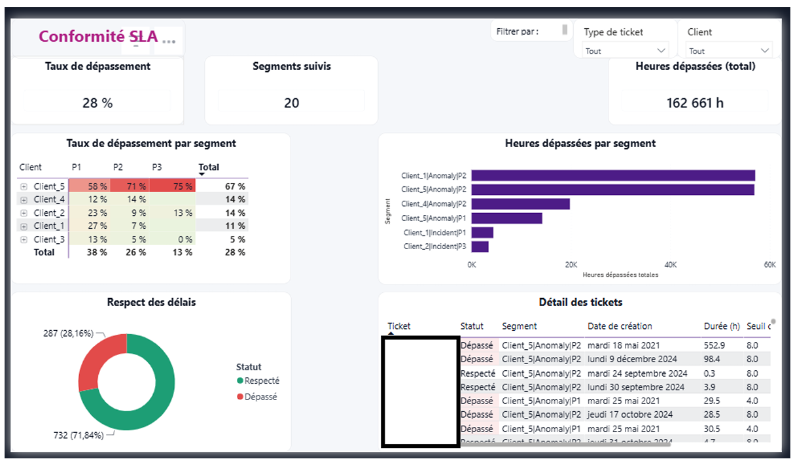
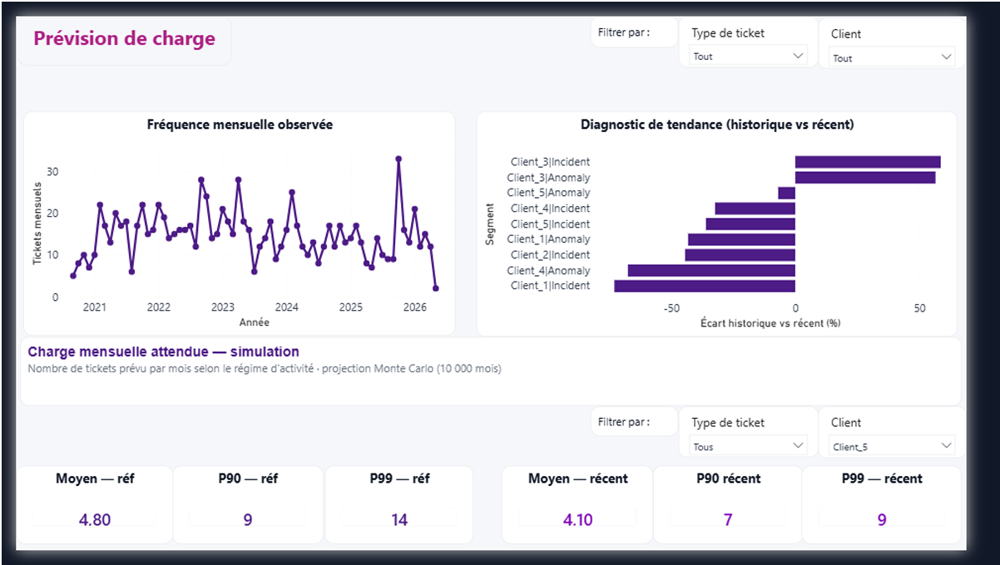
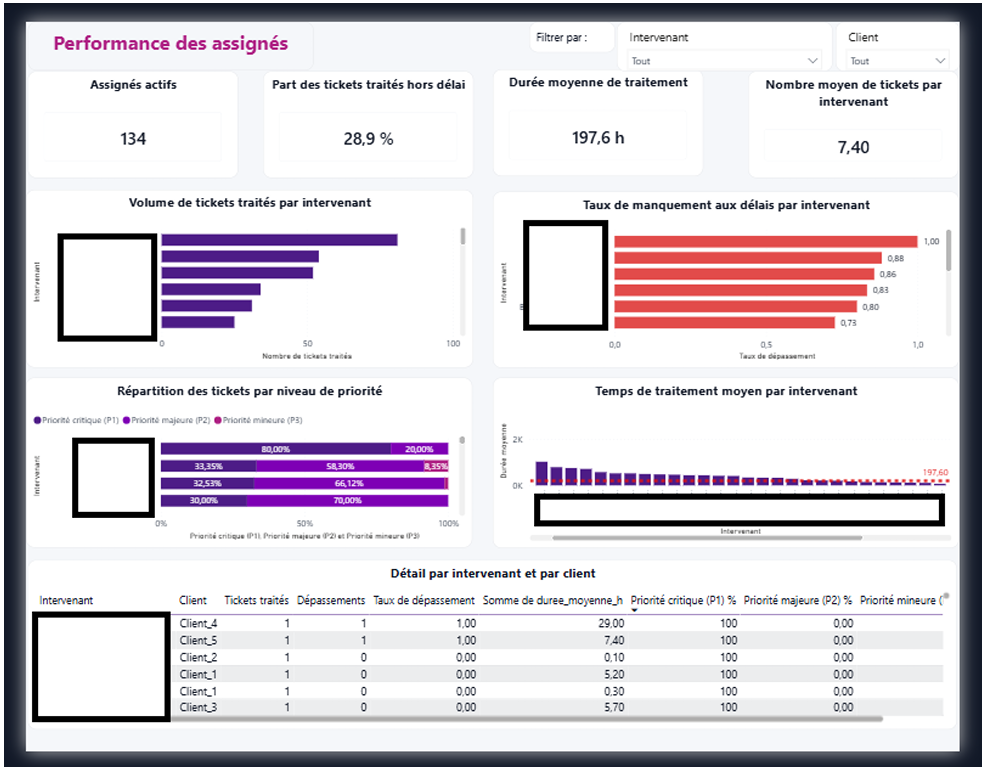
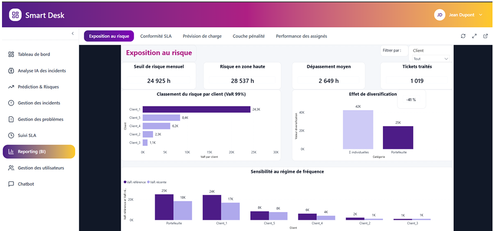

# SmartDesk

**An integrated decision-support solution combining client-information retrieval, actuarial SLA risk modelling, and business intelligence.**

> **Project context**  
> Developed during my final-year engineering internship (PFE) at **Sopra HR Software Tunisia**, within the ProdOps / Service Center department, from February to September 2026.
>
> **Public portfolio repository:** the proprietary source code, real Jira exports, client records, credentials, and internal configuration are not included. This repository documents the project through technical explanations and anonymized screenshots.

**Author:** Irad Hachaichi  
**Academic background:** Double degree in Data Science and Actuarial Science  
**Institutions:** ESPRIT · Institut du Risque et de l'Assurance (IRA), Le Mans Université

---

## Overview

SmartDesk addresses three operational challenges encountered in a Jira-based client-support environment:

1. **Scattered client information** — technical details, contacts, servers, and URLs were distributed across client records and free-text fields.
2. **Reactive SLA monitoring** — historical compliance indicators did not provide a probabilistic assessment of potential monthly breach exposure.
3. **Fragmented reporting** — operational indicators and actuarial risk outputs needed a unified decision-support interface.

The solution brings together three complementary modules:

| Module | Purpose | Main technologies |
|---|---|---|
| AI Assistant | Retrieve client information through natural-language questions | Python, FastAPI, Ollama, PostgreSQL |
| Actuarial SLA Risk Model | Estimate monthly SLA breach-hour distributions and tail-risk measures | Python, NumPy, SciPy, statistical modelling, Monte Carlo |
| Power BI Reporting | Present operational KPIs and actuarial outputs | Power BI, DAX, dimensional modelling |

The modules are **loosely coupled**: they can be developed and validated independently and exchange information through files and database tables.

## Architecture

A common Jira source provides two distinct exports:

- **Client records:** processed through an entity-oriented ETL pipeline and stored in a normalized PostgreSQL database for the AI Assistant.
- **SLA ticket records:** processed through a separate event-oriented pipeline and used by the actuarial model and reporting layer.

The actuarial outputs are then incorporated into the Power BI reporting model.

The React application provides a unified interface. The AI Assistant is consumed through a REST API; Power BI reports are integrated through Microsoft's Secure Embed mechanism.

**Deployment clarification:** data preparation, PostgreSQL and LLM inference were designed to run locally. The embedded Power BI report relies on Power BI Service and Microsoft account authentication; therefore, the complete solution should not be described as entirely offline or fully local.

## 1. AI Assistant — Natural-language client information retrieval

The assistant allows users to query structured client information using natural language.

Example questions:

- “Who is the CDM of Client X?”
- “Which contact should I reach if a server is down?”
- “What is the production query server for this client?”

### Design principles

- **Hybrid execution:** deterministic rules handle supported cases whenever possible; a locally hosted LLM is used when language interpretation is required.
- **Controlled NL-to-SQL:** the model does not have unrestricted authority to query the database.
- **Defensive validation:** query structure, requested fields, client resolution, and database access are checked.
- **Fail-closed behaviour:** ambiguous or unsupported requests are refused instead of being answered through guesses.
- **Conversational context:** follow-up questions can reuse a previously resolved client when appropriate.

The assistant uses Ollama with `qwen2.5:3b` as its default model, alongside Python, FastAPI, PostgreSQL, RapidFuzz and Pydantic.

### Evaluation snapshot

The project documentation reports the following evaluation results:

| Evaluation | Result |
|---|---:|
| Extended evaluation set | 50 questions |
| Global accuracy | 92.2% |
| Field selection | 94.6% |
| Valid SQL accepted by `EXPLAIN` | 97.7% |
| Result correctness | 100% |
| Unit tests | 212 passing tests |

A separate initial benchmark compared five compact local models on 20 questions. The default model was selected based on the combined evaluation of accuracy, field selection, result correctness, stability and CPU latency.

**Interpretation:** these figures describe the documented evaluation setup and test set. They should not be interpreted as a guarantee of performance on unseen questions or other databases.

More details: [AI Assistant technical documentation](docs/ai-assistant.md).

## 2. Actuarial SLA Risk Modelling

The actuarial module adapts the collective frequency–severity framework to monthly SLA breach exposure.

A ticket is treated as an exposure unit; a contractual threshold breach is treated as a claim; and the excess processing duration is the claim amount.

The aggregate monthly breach duration is represented by:

\[
S = \sum_{i=1}^{N} X_i
\]

where \(N\) is the number of breaches and \(X_i\) is the excess duration associated with breach \(i\).

### Modelling components

- Monthly frequency modelling using Poisson and Negative Binomial distributions.
- Bühlmann–Straub credibility to combine individual and collective experience.
- Severity fitting using Lognormal, Weibull, Gamma and Pareto distributions.
- Maximum Likelihood Estimation and information-criterion-based selection.
- Bootstrap-corrected goodness-of-fit assessment.
- Extreme Value Theory investigations and explicit severity capping.
- Stop-loss calibration.
- Hierarchical Monte Carlo simulation with 10,000 trajectories.
- Portfolio aggregation and empirical VaR / TVaR estimation at the 99% confidence level.

All risk measures are expressed in **breach hours**.

The model also includes sensitivity and robustness analyses. Its assumptions and limitations — including non-stationary frequency segments, sparse severity samples, tail-cap sensitivity and dependence not fully represented by the independent simulation framework — are documented explicitly.

More details: [Actuarial SLA Risk Model documentation](docs/actuarial-risk-model.md).

## 3. Power BI Reporting

The reporting module combines operational Jira indicators with outputs from the actuarial model.

### Data model

- Extended dimensional model.
- Four dimension tables and fourteen fact tables, as documented in the project overview.
- Precomputed actuarial outputs are imported for reporting.
- DAX measures are used for aggregation and presentation rather than repeating the statistical modelling.

### Report pages

The Power BI report contains five pages:

1. Risk Exposure
2. SLA Compliance
3. Workload Forecast
4. Penalty Analysis
5. Assignee Performance

The report is integrated into the React application using **Power BI Secure Embed**. Access remains subject to the viewer's Power BI permissions and Microsoft authentication requirements.

**Design principle:** *The notebooks calculate; Power BI displays.*

| Risk exposure | SLA compliance |
|---|---|
|  |  |

| Workload forecast | Assignee performance |
|---|---|
|  |  |

More details: [Power BI Reporting documentation](docs/power-bi-reporting.md).

## Data Engineering Pipeline

The client-information pipeline transforms a flat Jira spreadsheet export into a normalized PostgreSQL structure.

The documented workflow includes:

1. Spreadsheet-to-JSON conversion.
2. Data cleaning and normalization.
3. URL extraction.
4. Contact extraction from free-text fields.
5. Database-server extraction.
6. Query-server extraction.
7. Reporter association and relational integration.

The pipeline combines Python, regular expressions and local LLM-assisted extraction. JSON validation and raw-value fallback mechanisms help preserve source information when structured extraction fails.

The documented dataset structure contains 58 client records distributed across eight relational tables, with 1,787 records in total. These figures describe the project dataset and should only remain public if their disclosure is authorized.

More details: [Data Engineering Pipeline documentation](docs/data-engineering.md).

## My Contributions

My work focused on the design and implementation of the following components:

- Client-information extraction and structuring pipeline.
- Local LLM-assisted information extraction.
- AI Assistant backend and controlled NL-to-SQL workflow.
- Actuarial modelling of SLA breach risk, including calibration, simulation and risk measures.
- Power BI data preparation, dimensional reporting and integration into the application.
- Technical evaluation, validation and documentation of these components.

The React application hosting the modules was developed as a team effort. My work included integrating the AI Assistant and Power BI reporting components into that application.

## Technology Stack

| Area | Technologies |
|---|---|
| Programming and data processing | Python, pandas, NumPy, SciPy |
| AI and language models | Ollama, Qwen, RapidFuzz |
| Backend and validation | FastAPI, Pydantic, httpx |
| Database | PostgreSQL |
| Actuarial and statistical modelling | Frequency–severity modelling, credibility theory, EVT, Monte Carlo, VaR, TVaR |
| Business intelligence | Power BI, DAX, dimensional modelling |
| Front-end integration | React, Vite |
| Engineering practices | Git, GitLab, Scrum, ITIL |

## Repository Documentation

- [System Architecture](docs/architecture.md)
- [AI Assistant](docs/ai-assistant.md)
- [Actuarial SLA Risk Model](docs/actuarial-risk-model.md)
- [Data Engineering Pipeline](docs/data-engineering.md)
- [Power BI Reporting](docs/power-bi-reporting.md)
- [Confidentiality and Disclosure Checklist](docs/confidentiality-checklist.md)

## Scope and Limitations

This repository is a technical presentation of the project, not a source-code release.

It does not contain:

- Proprietary application source code.
- Real Jira exports or identifiable client information.
- Personal data, credentials, tokens or internal endpoints.
- Internal infrastructure details or confidential contractual information.

The actuarial model is a project-specific modelling framework. Its outputs depend on historical data, distributional assumptions, calibration choices and simulation design. The documentation therefore presents the methodology and limitations alongside the risk measures.

## Contact

**Irad Hachaichi**  
[LinkedIn](https://www.linkedin.com/in/irad-hachaichi-870497256/) · [Email](mailto:iradhachaichi2@outlook.com)

For further technical discussion about the architecture, modelling choices or evaluation methodology, feel free to get in touch.
